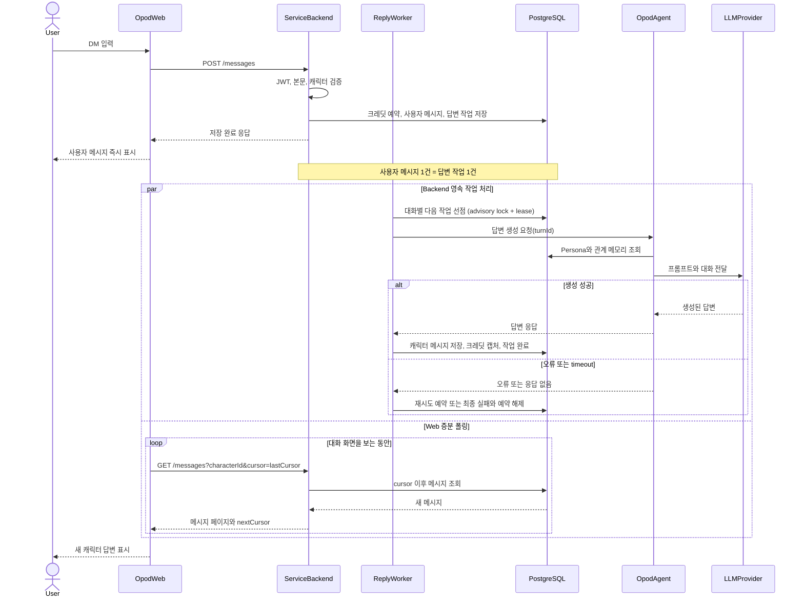

# 06. 아키텍처

> 분류 범례는 [00-overview.md](./00-overview.md) 참조. 모듈별 상세는
> [07-codebase-guide.md](./07-codebase-guide.md).

## Repository 의존 경계 (2026-09-22 확정)

필수 정본은 [개발 규칙](02-development-rules.md)의 “Repository 의존 절대 규칙”이다.
Repository는 테이블당 하나이고 소유 Domain Service만 의존한다.
Application / Facade / UseCase Service는 Domain Service들을 조합하며 Repository를 직접 사용하지 않는다.
B Domain Service가 A 테이블의 기능을 사용하려면 A Domain Service를 거쳐 A Repository에 접근한다.
Controller·Worker·다른 Repository의 직접 Repository 접근도 금지한다.

```text
Application Service -> A Domain Service -> A Repository
                    -> B Domain Service -> B Repository
B Domain Service    -> A Domain Service -> A Repository
```

아래 “사실” 절과 소셜 활동 런타임 설명은 현재 구현의 기록이다.
Domain Service의 직접 DB 접근이나 Worker → Repository 등 미준수 경로는
기존 구현 공백이며 새 코드의 정본 예시가 아니다. 이번 결정은 문서 규칙 확정이고
코드 리팩터링 완료를 뜻하지 않는다.

## System Shape (사실)

- 런타임: NestJS 10 (Node 26.12.1, TypeScript strict). 진입점 `src/main.ts` →
  `AppModule` → `CoreModule`.
- 주요 폴더:
  - `src/<area>/`: 기능별 HTTP 컨트롤러, 서비스, Repository, 모듈, 단위 테스트.
    입력 DTO는 기능 안의 `dto/`에 둔다.
  - `<area>.module.ts`는 도메인 provider, `<area>.http.module.ts`는 HTTP wiring을
    소유한다. 분리된 DI 경계를 유지해 도메인 간 의존이 HTTP 순환 의존을 만들지 않는다.
  - `src/core/core.module.ts`: HTTP 기능 등록과 전역 validation/logging 설정.
  - `src/core/database/`: 공유 DB 인프라(`DatabaseService`, Drizzle schema, transaction).
  - `src/shared/`: 페이지네이션·UUID·미디어 URL, 요청 interceptor, Swagger.
  - `drizzle/`: 정본 스키마에서 생성하고 검토한 SQL 마이그레이션.
- 소유권 경계:
  - 이 리포: 유저용 API + 공유 도메인 + **정본 스키마**.
  - opod-admin: 관리자 API·UI, 콘텐츠 작성/발행, 미디어 업로드, 스키마 미러.
  - opod-agent: 대화 생성(OpenAI 호환) + 관계 메모리(observation/reflection).
  - opod-web: 프론트엔드.

## Data Flow (사실)

- Inputs: 유저 HTTP 요청(`Authorization: Bearer` JWT), 결제/환불 webhook,
  클라이언트 이벤트(`POST /events`).
- Processing: 컨트롤러가 인증→도메인 서비스 호출. DM은 크레딧 예약→
  opod-agent 호출→캡처. `purchases`가 구매·환불 유스케이스를 조정하고,
  `payments`가 금전 상태·provider adapter, `credits`가 크레딧 원장을 소유한다.
- Outputs: JSON 응답(커서 페이지네이션), DB 기록, opod-agent로의 아웃바운드
  호출.
- Persistence: PostgreSQL(스키마 `opod`) + Drizzle ORM v1. UUIDv7 PK. 미디어는 URL/
  storageKey로 참조하고 공개 URL은 `S3_PUBLIC_BASE_URL`로 조립
  (`src/shared/media/media-url.ts`).

## DM Reply Sequence (구현됨)

DM 전송 요청은 **사용자 메시지와 영속 답변 작업 저장까지만 동기 처리**한다.
service-backend의 답변 worker가 저장된 작업을 가져가 기존 opod-agent API를
요청-응답 방식으로 호출하고 완료 결과를 저장한다. opod-web은 기존 메시지 조회
API에 마지막 cursor를 전달해 새 메시지를 주기적으로 조회한다. callback, SSE,
WebSocket은 이 구조의 범위에 포함하지 않는다.



### 확정된 계약

- `POST /messages`의 성공 기준은 사용자 메시지와 영속 답변 작업이 저장된
  시점이다. Agent 답변을 기다리지 않는다.
- service-backend가 답변 작업의 상태, 재시도, Agent 요청, 응답 저장을 소유한다.
  프로세스 내부의 일회성 Promise만으로 작업을 실행하지 않는다.
- 사용자 메시지 1건이 답변 작업 1건이고 답변 1건을 만든다. 연속 발화를 하나로
  묶어 한 번만 답하는 동작은 범위에서 제외했다(2026-08-11). 되살릴 때 스키마는
  바뀌지 않는다 — `messages.reply_job_id`가 이미 N:1이다.
- 같은 대화의 작업은 순서대로 하나씩 처리하고, 서로 다른 대화는 병렬 처리한다.
  Agent 문맥은 현재 답변 작업까지의 논리 순서로 구성하며 미래 작업의 메시지는 제외한다.
- Agent 응답의 공개 `opod` 메타데이터는 provider가 `{ body, experience? }`로 정규화한다.
  `parseCharacterExperience`가 thought·photo·relationship만 검증해 복사하며 native reasoning,
  tool/debug 필드는 저장하지 않는다. 유효하지 않은 선택 메타데이터는 정상 답변을 실패시키지 않는다.
  캐릭터 메시지의 nullable `experience`는 답변·크레딧 캡처·작업 완료와 함께 저장하고,
  이력/폴링 조회로 반환한다. 다음 Agent 요청의 대화 문맥에는 원문 body만 전달한다.
- 답변이 늦게 도착하므로 대화 전사는 시간순으로 [질문1, 질문2, 답변1, 답변2]처럼
  엇갈릴 수 있다. 어느 답변이 어느 질문의 것인지는 순서가 아니라 `turnId`가
  가리킨다.
- opod-agent는 기존 요청-응답 API로 답변을 반환한다. 비동기 작업이나 callback을
  새로 소유하지 않는다.
- 답변 작업과 Agent 요청은 사용자 메시지 ID인 `turnId`로 연결하며, worker 재시도
  후에도 캐릭터 메시지와 크레딧이 중복 반영되지 않아야 한다.
- opod-web은 새 실시간 전송 채널을 열지 않고 기존 `GET /messages`의 cursor를
  이용해 마지막 조회 이후 메시지만 가져온다.
- worker의 성공 처리에서 캐릭터 메시지 저장, 크레딧 캡처, 작업 완료는 하나의
  완료 단위로 다뤄야 한다.
- Agent 연결 실패, 일시 장애, timeout은 동일한 `turnId`로 최초 요청을 포함해
  최대 3회 시도한다. 영구 실패는 재시도하지 않으며, 성공 결과와 크레딧은 한
  번만 반영한다.
- 크레딧은 작업마다 한 번 예약한다. 이 예약은 `expires_at`이 null이라 시간으로
  만료되지 않고 작업이 직접 capture/release한다 — 독립 TTL을 두면 답변 성공과
  예약 만료가 경합한다. 가용 잔액과 환불 차단 판정에는 활성 예약으로 포함된다.
  실제 처리가 시작된 뒤 15분 안에 성공하면 캡처하고, 최종 실패하거나 15분을
  넘으면 해제한다.
- 최종 실패 시 사용자 메시지는 유지하고 작업을 `failed`로 기록하며, 크레딧
  예약을 해제한 뒤 다음 작업을 계속 처리한다. 사용자에게는 내부 실패 원인을
  노출하지 않는다.
- 실패한 작업은 사용자가 명시적으로 재시도할 수 있다. 재시도는 `readyAt`을 다시
  찍어 현재 대화의 마지막 순서에 배치하고 새 크레딧 예약과 최대 3회·15분 정책을
  적용하며, 동시 재시도는 상태 가드로 하나만 살아남고 진 쪽은 예약을 되돌린다.

### Agent에 전달하는 대화 순서

답변 생성 중 다음 사용자 메시지가 먼저 저장될 수 있으므로 메시지 저장 시각을 그대로 Agent 문맥 순서로 쓰지 않는다. 현재 작업까지의 `replyJob.createdAt/id`로 작업 순서를 정하고, 같은 작업 안에서는 사용자 → 캐릭터 순으로 정렬한다. 따라서 저장 순서가 `user1 → user2 → assistant1`이어도 두 번째 작업의 입력은 `user1 → assistant1 → user2`다. 미래 작업 메시지는 제외한다. `replyJobId = null`인 레거시 메시지는 기존 사용자 턴의 시각·ID 경계를 사용하며, 작업 연결 정보가 없는 과거 행의 잘못된 순서를 추정해 복원하지 않는다.

### worker 실행

worker는 새 스케줄러 의존성 없이 서비스 프로세스 안에서 재귀 `setTimeout` tick으로
돈다. tick이 필요한 이유는 두 가지다. 재시도는 `ready_at`이 미래인 작업을 만들고,
프로세스가 죽으면 메모리에 있던 신호가 사라져 `queued` 작업과 만료된 lease를
아무도 집지 않는다. 선점은 대화 단위 advisory lock 안에서 하고, 처리 중에는 DB
lease가 소유권을 표시한다. 동작 값은 `MESSAGE_REPLY_*` 환경변수로 조정하며,
`MESSAGE_REPLY_WORKER_ENABLED=false`면 API만 뜨고 worker는 돌지 않는다.

opod-web의 `MessageThreadContent`는 pending 작업이 있는 동안 기존 cursor API를 폴링한다.
일반 화면에서는 1.5초, document가 숨겨진 상태에서는 5초 간격이며 effect 정리 시 폴링을 중단한다.
완료 답변은 대화에 병합하고 실패 턴은 알림을 표시한다. 이 코드 확인은 브라우저 E2E나 실기기 검증을 새로 실행했다는 뜻이 아니다.

### 전송 경계 (향후)

현재 worker와 opod-agent 사이에는 기존 HTTP 요청-응답을 사용한다. 차후에는 영속
답변 작업의 의미와 사용자 API를 유지한 채 이 구간을 메시지 브로커(MQ 또는
Kafka) 기반 전달로 교체한다. 이번 구현에서는 브로커 의존성이나 추상화를 미리
추가하지 않는다. (결정/유보)

## Integrations (사실)

- 외부 서비스:
  - opod-agent (`OPOD_AGENT_URL`): DM 답장 생성. OpenAI 호환 chat completion,
    `x-opod-*` 헤더로 관계 식별, `OPOD_AGENT_TIMEOUT_MS`로 설정하는 기본 300초
    타임아웃
    (`src/messages/message-reply.provider.ts`).
  - S3 (`S3_PUBLIC_BASE_URL`): 미디어 공개 URL.
  - 결제 provider: 공통 `PaymentProvider` 경계 뒤에 Web Polar, Apple App Store,
    Google Play adapter가 있으며 local adapter는 개발 환경 전용이다. 운영 전환에는
    credential·상품 ID 등록과 sandbox 검증이 필요하다.
  - 성인인증 provider: **미구성**(production에서 501). 실연동 방향 미정. (미해결)
- 내부 서비스: opod-admin(공유 스키마 미러), opod-agent(공유 스키마의 agent_*
  테이블 read/write).
- 큐/스케줄 잡: 생성·기획·게시(`generation_jobs`, `post_drafts`), consolidation
  (`agent_memory_jobs`)는 **opod-admin/opod-agent가 소유**. 이 리포는 스키마만
  가지며 잡을 실행하지 않는다. (현재 사실 — 스키마 주석) 목표 구조의 DM 답변
  작업은 관리자 생성 잡과 별개이며 service-backend가 소유한다. (결정)

### Character social activity schema foundation (2026-09-18)

- `characters.timezone` is the shared IANA living timezone for all character
  capabilities. It is nullable during the transition so existing characters
  remain valid; the admin character write API validates a supplied IANA
  timezone before persisting it. The database currently enforces only
  non-empty, trimmed text.
- Social activity policy windows use local wall-clock time with an inclusive
  start and exclusive end and may wrap midnight. Runtime daily limits
  use the character's local calendar day. DST-shortened or DST-lengthened days
  remain one local calendar day; runtime must convert each boundary with the
  timezone rules effective for that date rather than assuming 24 elapsed hours.
- Views and character follows are durable composite-key facts. Social activity
  jobs use a generated-always BIGINT identity, durable state/lease constraints,
  and at most one queued or running job per character.
- Post reactions permit either a user actor or a character actor, plus legacy
  rows with both actors null after existing `ON DELETE SET NULL`. Mixed actors
  and duplicate character reactions are invalid. Automated likes and manual
  admin character reactions share the existing reaction table.
- New social foreign keys use `ON UPDATE CASCADE ON DELETE RESTRICT`. Current
  character removal is a soft status update, so it remains compatible. Before
  applying the migration to a shared database, preflight historical
  `post_reactions` for mixed actors and duplicate non-null character reactions;
  the migration intentionally fails instead of deleting or rewriting data.
- The schema migration is provided as artifacts. This work does not apply
  them to a persistent local DB, development DB, or any future production DB.

### Character social activity runtime (2026-09-22)

- `src/character-social` owns the non-LLM scheduler and executor.
  `CharacterSocialWorker.runOnce` delegates scheduling and execution to
  `CharacterSocialActivityApplicationService`. Its `scheduleDueActivities` and
  `processNextActivity` compose owning services; the worker does not access repositories. The automatic loop is opt-in with `CHARACTER_SOCIAL_WORKER_ENABLED=true`;
  the default is disabled. Apply the schema migration before enabling it.
  Boot options also include `CHARACTER_SOCIAL_POLL_INTERVAL_MS` (5000),
  `CHARACTER_SOCIAL_BATCH_SIZE` (20), `CHARACTER_SOCIAL_MAX_ATTEMPTS` (3),
  `CHARACTER_SOCIAL_LEASE_MS` (60000), and
  `CHARACTER_SOCIAL_RETRY_BACKOFF_MS` (5000). The run and follow thresholds
  use `CHARACTER_SOCIAL_POSTS_PER_RUN` (5) and
  `CHARACTER_SOCIAL_MIN_LIKED_POSTS_TO_FOLLOW` (3).
- Repository ownership is explicit: Character, Post, PostReaction,
  CharacterPostView, CharacterFollow, CharacterSocialActivityPolicy and
  CharacterSocialActivityJob each have one Repository and its sole owning
  Service. Names omit `Domain`. Services own decisions; repositories own
  persistence. CharacterFollowService obtains reaction counts through PostReactionService.
- `CharacterService.withActivityTransaction` delegates to CharacterRepository,
  which opens the transaction and character advisory lock. Each repository injects the shared
  `DatabaseTransactionContext` provider from DatabaseModule, which propagates
  that transaction with AsyncLocalStorage.
  Other services use their own repositories; neither application nor domain
  services receive the database client. Nested work joins the active transaction,
  and an expired context cannot be reused.
- This slice does not refactor the old public `CharactersService`/`PostsService`
  database access. Those legacy paths are not examples of the mandatory rule.
- An active character with an enabled policy and valid `characters.timezone`
  can act within its local time window. There is no inferred timezone. A
  timezone edit takes effect on the next execution, and quotas are recomputed
  against that timezone's current calendar day. Historical instants are retained.
- Candidate posts have active authors, are already published by creation time,
  are not the actor's own posts and have not been viewed by that actor. Matching
  uses interests and hashtags after trimming, removing a leading `#`, and
  lowercasing; it is exact text matching without translation or semantic search.
  Empty or unmatched interests produce no new views.
- The default run views at most five newest matching posts, likes newly viewed
  posts using the policy probability, and follows an author after three distinct
  liked posts. Daily view, like and follow caps are independent; existing manual
  character likes count toward the automatic like allowance. Manual admin writes
  are not themselves limited by an automation policy.
- Per-character transaction advisory locks use `character_social:<UUID>` in
  both backend and admin. Schedule advancement and enqueue are atomic; missed
  intervals do not create a backlog burst. Lease tokens fence retries, and activity
  effects plus job completion commit together. Expired jobs are retried at most
  three attempts by default. Disabling a policy cancels unfinished jobs.
- UTC instants are stored in `TIMESTAMPTZ`; PostgreSQL converts local midnight
  and the next local midnight separately. A 23-hour or 25-hour DST day has one
  quota. This does not use the fixed-KST attendance rule.
- Admin owns character timezone and `GET/PUT
  /api/admin/v1/characters/:id/social-activity-policy`. The policy PUT supplies
  enabled, local window, interval, three daily limits and like probability.
  Missing policies are returned as null. Jobs expose BIGINT IDs as strings.
- Public human analytics, cosmetic web view counts and user-follow counts retain
  their existing behavior. Comments, unfollow, admin UI and live deployment are
  outside this runtime slice.
- Regression evidence: `test/character-social-runtime.e2e-spec.ts` uses a
  disposable PostgreSQL database for filtering, local quotas, DST, concurrent
  workers, lease recovery and cancellation. No persistent local or development
  database is modified by these tests.

### 네이티브 결제: 현재 서버 계약과 연결 공백

현재 서버의 상품 조회는 `GET /purchases/products?channel=apple|google`, 계정 연결값은 인증된 `GET /purchases/account-token`이다. 검증 API는 `POST /purchases/in-app/apple/verify`와 `POST /purchases/in-app/google/verify`이고 본문은 `{ productId, proof }`다. `proof`는 Apple signed transaction 또는 Google purchase token이다. 서버는 상품 매핑과 store가 검증한 계정 연결값·상태를 확인하고, provider transaction key의 잠금·unique 제약 아래 구매·금전 원장·크레딧 지급을 함께 확정한다. 같은 사용자의 재요청은 기존 구매를 반환하며 다른 사용자의 재청구는 거절한다. store proof 원문을 DB에 보관하지 않는다.

현재 Web `IapService`는 제안 계약인 `/credits/iap/catalog`, `/credits/iap/intents`, `/credits/iap/verify`를 호출하고 `canFinish`를 기대한다. 이 경로·intent·`canFinish` 응답은 현재 backend에 없다. 따라서 서버 adapter 구현과 native 구매 완료 연결은 구분한다. 지급 확인 전 native transaction을 finish하지 않는 것은 후속 클라이언트 계약의 목표다. 현재 Google adapter는 store 검증 중 consume을 실행한 뒤 내부 지급 transaction을 시작하므로, 이 순서와 지급 실패 시 복구도 미해결 사항이다. 양쪽 API를 맞추고 store sandbox·실기기 검증을 완료하기 전까지 전체 연동 완료로 표시하지 않는다.

### Push 알림 후속 계약 — 제안·미구현

현재 알림은 인앱 목록·읽음과 팔로우 알림 동기화다. push device 저장, sender, ticket/receipt worker는 구현하지 않았다. 후속 제안은 설치별 UUID `installationId`의 인증된 PUT/DELETE 등록이며 Expo Push Token을 transport로 사용한다. 동일 설치의 token rollover와 같은 기기의 계정 전환은 이전 association revoke와 신규 owner 연결을 원자적으로 처리한다. DELETE는 없거나 다른 사용자 소유여도 존재를 노출하지 않고 204로 멱등 처리한다. project/app allowlist, token 형식·길이·rate limit을 검증하고 raw token은 key version을 가진 암호문, 비교값은 keyed hash로 분리한다.

발송은 public 임의-send API 대신 Notification 생성 트랜잭션의 outbox로 연결한다. device별 delivery uniqueness와 worker lease로 중복 처리를 막고, Expo ticket과 receipt를 구분해 저장한다. `DeviceNotRegistered` receipt는 device를 invalid 처리해 다음 발송에서 제외한다. payload는 임의 URL 대신 version/type/notificationId와 접근 권한을 검증한 typed target을 사용한다. timeout·429·5xx에는 제한된 backoff 재시도, permanent 오류와 최대 시도 초과에는 dead letter를 적용한다.

worker 방식, dead-letter 운영 주체, ciphertext retention·key 관리·rotation, webhook/발송 지연 지표와 alert는 미결정이다. 앱은 권한·token 획득과 서버 등록을 구분하고 PUT이 성공하기 전 등록 완료를 표시하지 않는다. 구체적인 sample·오류 코드·제안 스키마·환경 변수는 외부 보관함의
[네이티브 연동 원본 계약](../../../opod-evaluation-archive/2026-09-29-cleanup-recovery/documents/opod-service-backend/docs/native-integrations-handoff.md)에 보존한다.

### Store 이벤트와 운영 검증 범위

현재 webhook 진입점은 `/payments/webhooks/:provider`이며 `google`은 내부 provider `google_play`로 정규화한다. Apple은 notification과 nested transaction JWS를 검증한다. Google은 Pub/Sub OIDC audience·허용 service account·verified email과 package를 검사한 뒤 RTDN 종류를 내부 event로 변환한다.

기존 제안의 Google Publisher API authoritative state 재조회, subscription allowlist와 Voided Purchases 정기 reconciliation은 현재 adapter에 없다. 미상 transaction의 durable retry/dead-letter, 이벤트 지연·실패 alert와 실기기/서명 sandbox 검증도 구현·실행 근거를 따로 확인해야 한다. 코드의 서명 검증 경로가 있다는 것만으로 이 후속 운영 계약까지 완료됐다고 표시하지 않는다.

## Operational Constraints

- 성능: 커서 페이지네이션(limit ≤ 50), 인덱스 기반 조회. pgvector는 트리거
  도달 시 도입(db-management.md).
- 보안: JWT(HS256, `AUTH_JWT_SECRET`), scrypt 비번 해시, refresh token은 해시로
  저장·폐기, 세션 advisory lock, 성인인증 식별키는 HMAC 해시로만 보관
  (`ADULT_IDENTITY_HASH_SECRET`). 원문 성인인증 응답·주민번호 미저장.
- 프라이버시: 개인정보 최소수집(IP·UA 미저장). 탈퇴 시 익명화 + 증빙 보존.
  **결정 변경**: 이메일 원문은 법적 보관기간 유지(재가입 차단) — 코드 반영 대기
  (gap, 01-roadmap).
- 신뢰성: 크레딧 예약/캡처/해제 멱등, 사용자 단위 직렬화. DM 답장 실패는
  예약 해제 + `service_logs` 기록. 결제 provider event는 서명 검증 후 고유 event
  ID로 한 번만 처리하고, provider transaction key로 중복 지급을 차단한다.

## Decision Records

| 날짜       | 결정                                                                                                                         | 이유                                                                                                    | 대안                                                                 |
| ---------- | ---------------------------------------------------------------------------------------------------------------------------- | ------------------------------------------------------------------------------------------------------- | -------------------------------------------------------------------- |
| 2026-07-19 | 스키마 변경은 이력 기반 migration으로 일원화                                                                                | `db push` 수동 적용이 배포 DB drift 사고를 냄                                                           | db push 유지(기각)                                                   |
| 2026-08-31 | Prisma를 Drizzle ORM v1으로 완전 대체하고 기존 DB는 검증 후 baseline 등록                                                   | 런타임·스키마·마이그레이션 소유자를 하나로 통일하고 기존 DDL 재실행을 방지                              | 두 ORM 병행(기각), 기존 DB에 baseline DDL 재실행(기각)               |
| (스키마)   | agent 관계 메모리 테이블을 이 리포 스키마에 호스팅(FK 없음, TEXT id)                                                         | 정본 스키마 소유자가 여기이고, 식별자는 X-Opod-* 헤더로 유입                                            | 별도 DB(기각)                                                        |
| (스키마)   | 임베딩·캡션 등 파생 데이터는 정본 아님, 백필 재생성                                                                          | 모델 교체·장애가 "백필 재실행"으로 수렴                                                                 | 정본 취급(기각)                                                      |
| 2026-07-29 | 데이터 전면 무기한 보존                                                                                                      | 정리 배치 없이 단순 유지                                                                                | 보존기간 정리(기각)                                                  |
| 2026-07-29 | 실시간 채팅 목표 = POST+SSE (2026-08-10 결정으로 대체)                                                                       | 당시 스트리밍 UX 목표                                                                                   | WebSocket(후보)                                                      |
| 2026-08-04 | purchases/payments/credits 분리, Web Polar + Apple/Google IAP                                                                | PG 교체와 금전·재화 책임 분리                                                                           | Polar 직접 의존(기각), 일반 Order(기각)                              |
| 2026-08-10 | DM = 메시지·영속 작업 저장까지 동기, 연속 발화 묶음별 직렬 답변, Backend worker가 Agent 요청-응답 처리, Web은 cursor polling | 사람처럼 연속 발화를 한 번에 이해하면서 긴 HTTP 요청과 작업 유실을 피하고 기존 Agent·조회 계약을 재사용 | 메시지별 병렬 답변·Agent callback·POST+SSE(대체), WebSocket(범위 밖) |
| 2026-08-10 | Agent 일시 장애·timeout은 동일 turnId로 최대 3회 시도하고, 차후 Backend↔Agent 전송을 MQ 또는 Kafka로 교체                    | 현재 답변 신뢰성을 확보하면서 transport 전환 경계를 보존                                                | 재시도 없음·timeout 재시도 제외(기각), 브로커 선도입(유보)           |
| 2026-08-10 | chat_reply 크레딧은 발화 묶음마다 한 번 예약하고 작업 상태에 연동하며, 처리 시작 후 15분에 최종 종료                         | 독립 TTL로 답변 성공과 예약 만료가 경합하거나 장애 시 무기한 잠기는 문제 방지                           | 독립 5분 TTL·실행 직전 예약(기각)                                    |
| 2026-08-10 | 최종 실패는 발화 묶음 failed + 예약 해제 후 다음 묶음을 처리하고, 명시적 재시도는 대화 마지막에 새 처리 기회로 배치          | 메시지 보존·대화 진행·순서 일관성을 유지하면서 사용자가 복구 가능                                       | 대화 전체 정지·자동 무한 재시도·과거 순서 삽입(기각)                 |
| 2026-08-11 | 발화 묶음을 첫 구현 범위에서 제외. 사용자 메시지 1건 = 답변 1건 = 크레딧 1회                                                 | 비동기 전환 자체를 먼저 세우기 위해 범위를 줄임. `messages.reply_job_id`가 N:1이라 되살릴 때 스키마 변경 없음. 대가는 연속 발화의 중복 답변·중복 차감 | 묶음 동시 구현(유보)                                                 |
| 2026-08-11 | worker는 새 스케줄러 의존성 없이 프로세스 내 재귀 setTimeout tick                                                            | 재시도의 미래 `ready_at`과 크래시 후 만료 lease 회수는 시간 기반 트리거가 있어야 한다. 브로커를 미리 만들지 않는다는 결정과도 일관 | `@nestjs/schedule` 도입(기각), LISTEN/NOTIFY(스윕을 못 대체, 기각)   |

세부 아키텍처 판단은 opod-agent의 ADR(`opod-agent/docs/adr/*`)도 참조(대화·
메모리 계약). 이 리포 밖 근거이므로 변경 전 확인 필요.
