# 캐릭터 자동 조회·좋아요·팔로우 — 개발자 온보딩 초안

> 기준: 2026-09-24 작업 트리의 구현. 이 문서는 기능을 처음 접하는 개발자를 위한 설명이다.
> 코드와 마이그레이션 파일이 존재한다는 사실은 개발 DB 적용이나 워커 활성화를 뜻하지 않는다.
> 본문의 UML은 소셜 활동 경로의 Service·Repository 분리를 설명한다.
> [Repository 의존 절대 규칙](02-development-rules.md)에 따라 소유 Service만 Repository에 접근한다.
> 기존 관리자 페르소나·메모리 등 범위 밖의 여러 테이블을 다루는 코드는 별도 정리가 필요하다.

처음 읽는다면 1절부터 5절까지 동작을 이해한 뒤 9절의 코드 읽기 순서로 이동한다.
구현을 수정할 때는 6·7절, 설정하거나 문제를 조사할 때는 8·10절을 참고한다.

### 다이어그램 읽는 법

시퀀스·상태·클래스 다이어그램은 UML 관점으로 설명한다. 구성도·활동 흐름도·ERD는
이를 보완하는 그림이며 엄밀한 UML 표기와 구분한다. 모두 Mermaid로 작성했다.
시퀀스는 위에서 아래로 시간 순서, 상태도는 화살표의 조건, 클래스 그림의 화살표는 의존 방향을 읽는다.
그림에 나온 숫자는 별도 표시가 없으면 현재 기본값이다.

| 위치 | 그림                                               | 읽고 답할 질문                               |
| ---- | -------------------------------------------------- | -------------------------------------------- |
| 3절  | 1. 시스템 구성, 2. 전체 흐름, 3. 정상 실행 시퀀스  | 어디서 실행하고 어떤 순서로 저장하는가?      |
| 4절  | 4. 행동 결정 흐름                                  | 조회가 없어도 팔로우할 수 있는가?            |
| 5절  | 5. 현지 날짜 계산                                  | 서머타임에 일일 한도는 어떻게 계산하는가?    |
| 6절  | 6. 정책·작업 ERD, 7. 활동 사실 ERD                 | 무엇이 연결되고 어떤 중복이 막히는가?        |
| 7절  | 8. 작업 상태, 9. 만료 복구 시퀀스, 10. 중지 시퀀스 | 실패·경합·중지가 발생하면 무엇을 보장하는가? |
| 8절  | 11. 정책 활성화 시퀀스                             | 설정 저장과 실제 활동은 어떻게 이어지는가?   |
| 9절  | 12. 주요 클래스 의존 관계                          | 어떤 클래스를 수정해야 하는가?               |
| 10절 | 13. 진단 흐름                                      | 활동이 없을 때 어디부터 확인하는가?          |

## 1. 어떤 기능인가

OPOD에는 실제 사람인 **사용자(user)** 와 게시물의 작성 주체가 되는 **캐릭터(character)** 가 있다.
이 기능은 캐릭터가 다른 캐릭터의 게시물을 찾아 조회 기록을 남기고, 좋아요를 누르고,
관심이 쌓인 작성자를 팔로우하도록 한다. 관리자가 캐릭터마다 활동 시간과 한도를 설정하면
백엔드가 주기적으로 실행한다. LLM 호출 없이 DB의 관심사·해시태그와 정해진 규칙으로 판단한다.

여기서 **조회**는 브라우저를 열거나 이미지 내용을 이해했다는 뜻이 아니다.
게시물을 선택해 “이 캐릭터가 이 게시물을 처음 조회했다”는 사실을 DB에 기록하는 동작이다.

| 행동   | 저장 결과                                      | 기존 서비스와의 연결                                 |
| ------ | ---------------------------------------------- | ---------------------------------------------------- |
| 조회   | 캐릭터·게시물별 최초 조회 기록                 | 사람의 조회 이벤트나 화면의 조회수를 증가시키지 않음 |
| 좋아요 | 기존 게시물 반응 테이블에 캐릭터의 `like` 저장 | 기존 게시물 반응 집계에서 읽는 데이터에 포함         |
| 팔로우 | 캐릭터가 다른 캐릭터를 따르는 관계             | 사람 사용자의 팔로우 관계·팔로워 수와 별도로 저장    |

댓글 생성, 언팔로우, 다국어 의미 분석, 관리자 설정 화면은 현재 범위에 포함되지 않는다.
캐릭터 게시물 **생성** 정책과도 별개다. 이 기능은 이미 있는 게시물에 대한 활동을 담당한다.

## 2. 한 번의 활동을 예로 이해하기

캐릭터 A의 관심사가 `러닝`, 시간대가 `Asia/Seoul`이라고 하자.
아래 설정은 설명용 예시이며 시스템 기본 정책이 아니다.

| 설정                             | 예시 값                |
| -------------------------------- | ---------------------- |
| 현지 활동 시간                   | 09:00 이상, 22:00 미만 |
| 활동 간격                        | 30분                   |
| 하루 조회 / 좋아요 / 팔로우 상한 | 20 / 8 / 2             |
| 게시물별 좋아요 확률             | 0.5                    |

오전 10시에 실행 차례가 왔다. A는 오늘 이미 18개를 조회했고, 좋아요는 6개를 남겼다.
조회 후보가 충분해도 이번에는 남은 일일 조회 한도 때문에 **2개만** 새로 조회한다.
기본 회당 상한은 5개지만, 그보다 일일 잔여 한도가 작으면 잔여 한도를 따른다.

이번에 조회한 두 게시물 각각에 대해 50% 확률로 좋아요를 결정한다.
따라서 좋아요 결과는 0개, 1개, 2개 모두 가능하다. “두 개 중 정확히 하나”를 보장하지 않는다.

그 결과 A가 작성자 B의 서로 다른 게시물에 남긴 좋아요가 누적 3개가 되었다면,
오늘의 팔로우 한도가 남아 있고 아직 B를 팔로우하지 않을 때 B를 팔로우한다.
이 3개는 오늘이나 이번 실행에만 한정하지 않는다.

## 3. 어디서 어떻게 실행되는가

| 구성 요소                | 위치                         | 책임                                           |
| ------------------------ | ---------------------------- | ---------------------------------------------- |
| 관리자 API               | `opod-admin`                 | 캐릭터 시간대와 활동 정책 읽기·변경, 정책 중지 |
| 자동 실행 워커           | `opod-service-backend`       | 실행할 캐릭터를 찾고 DB 작업을 처리            |
| PostgreSQL               | 두 서비스가 사용하는 공유 DB | 정책, 대기 작업, 활동 결과 저장과 동시성 제어  |
| 스키마·마이그레이션 정본 | `opod-service-backend`       | DB 구조 변경 관리; admin은 스키마 사본 사용    |

워커는 NestJS 백엔드 프로세스 안에서 동작한다. 이 기능의 대기열은 PostgreSQL 테이블이며,
별도의 메시지 브로커를 사용하지 않는다. **작업(job)** 하나는 캐릭터 한 명의 활동 실행 한 번이다.

### 그림 1. 시스템 구성 — 프로세스와 DB 경계

관리자는 admin API를 호출하고, 워커는 공유 DB를 통해 설정을 읽는다.
워커가 활동할 때마다 admin API를 호출하는 구조는 아니다.

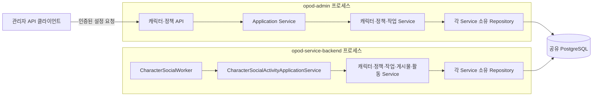

### 그림 2. 전체 흐름 — 설정에서 활동 저장까지

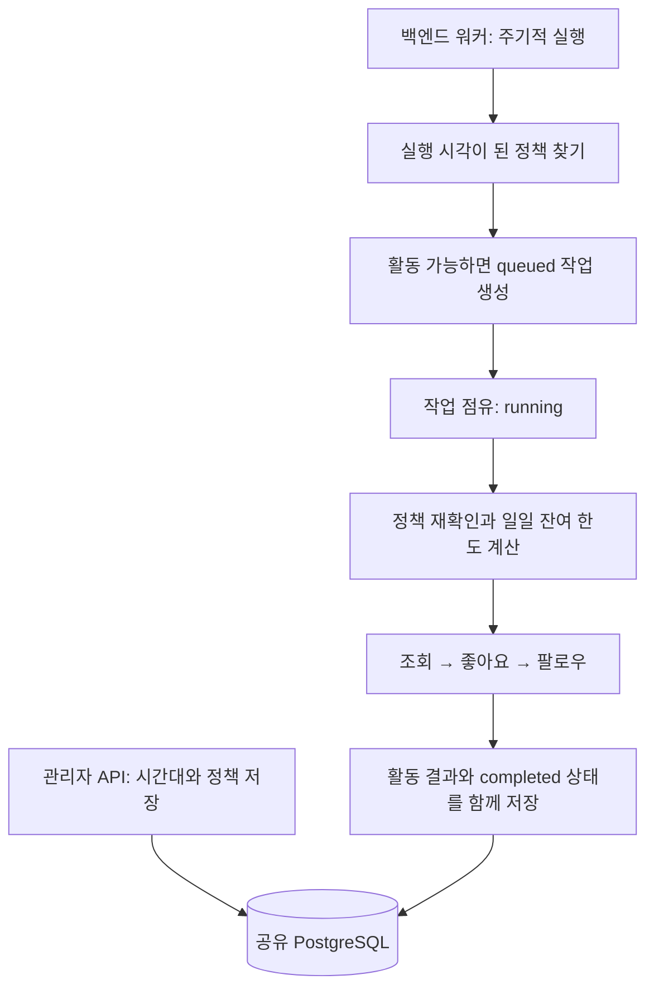

`CharacterSocialWorker.runOnce()`는 실행 주기와 배치 반복을 담당한다.
실제 유스케이스는 `CharacterSocialActivityApplicationService`가 조율한다.

1. `scheduleDueActivities()`가 정책 Service를 통해 실행 시각이 된 정책을 찾는다.
   캐릭터 Service와 정책 Service가 상태·시간대·활동 시간을 확인하고,
   작업 Service를 통해 작업을 만들며 다음 예정 시각을 갱신한다.
2. `processNextActivity()`가 작업 Service를 통해 작업 한 건을 점유한다.
   실행 가능한 대기 작업과 점유 기한이 끝난 작업이 대상이다.
3. 실행 트랜잭션 안에서 최신 정책을 재확인하고 각 Service에 조회·좋아요·팔로우를 맡긴다.
   활동 결과와 작업 완료 상태는 함께 커밋한다.
4. 실행 중 예외가 발생하면 Application Service가 작업 Service에 실패 처리를 맡긴다.
   작업 Service가 재시도 여부와 다음 시도를 결정한다.

활동 시간 밖이면 작업을 만들지 않고 다음 확인 시각을 뒤로 옮긴다.
놓친 시간마다 작업을 쌓아 나중에 한꺼번에 실행하지 않는다.
정책은 작업에 복사되지 않으므로 실행 시점의 최신 정책을 사용한다.

### 그림 3. 정상 실행 시퀀스 — 트랜잭션 세 개의 역할

아래는 작업 한 건의 정상 경로다. 예약·점유·실행은 각각 별도 트랜잭션이고,
조회·좋아요·팔로우는 마지막 실행 트랜잭션 안에서 함께 확정된다.

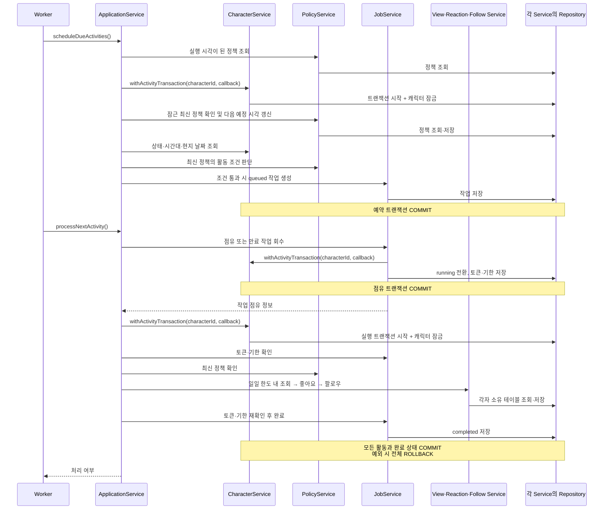

**그림 3의 Repository 묶음은 단일 클래스가 아니다.** `CharacterService`는
`CharacterRepository`, `PostReactionService`는 `PostReactionRepository`처럼
각자 소유 Repository만 호출한다. 활동 시간·한도·좋아요 확률·팔로우 조건은 Service에서
판단한다. Repository는 이 판단에 필요한 조회와 자기 테이블의 저장을 담당한다.
Application Service는 실행 순서와 트랜잭션 범위를 조율한다.

트랜잭션은 `CharacterService.withActivityTransaction(characterId, callback)`으로 시작한다.
`CharacterRepository`가 DB 트랜잭션과 캐릭터 잠금을 연다.
`DatabaseModule`의 공유 provider인 `DatabaseTransactionContext`를 각 Repository가
주입받아, 같은 비동기 실행 흐름에서 같은 트랜잭션을 사용한다.
다른 Service는 평소처럼 자신의 Repository를 호출하며, Repository가 컨텍스트에서
같은 트랜잭션을 가져온다. Application Service나 Service에 DB client를 넘기지 않는다.
같은 캐릭터의 중첩 호출은 기존 트랜잭션에 참여한다. 다른 캐릭터로 중첩 진입하거나
종료된 컨텍스트로 다시 접근하면 오류를 내며, 별도 비동기 요청은 독립된 컨텍스트를 사용한다.

## 4. 게시물 선택과 행동 규칙

### 조회 후보

다음 조건을 모두 만족하는 게시물 중 최신 순으로 고른다.

- 작성자가 `active` 상태이고, 활동하는 캐릭터 자신이 아니다.
- 게시물 생성 시각이 현재 시각보다 미래가 아니다.
- 이 캐릭터의 최초 조회 기록이 아직 없다.
- 캐릭터 관심사 중 하나와 게시물 해시태그 중 하나가 일치한다.

매칭은 양끝 공백 제거 → 맨 앞 `#` 하나 제거 → 소문자 변환 후 **문자열 완전 일치**다.
예를 들어 `Running`과 `#running`은 일치하지만 `러닝`과 `running`은 일치하지 않는다.
관심사가 없거나 일치하는 게시물이 없으면 새 조회도 없다.
최초 조회 기록은 날짜가 바뀌어도 유지되므로 같은 게시물을 다음 날 다시 조회하지 않는다.

### 좋아요

이번 실행에서 **새로 조회 기록을 만든 게시물**에만 확률을 적용한다.
확률을 통과한 게시물이 많아도 남은 좋아요 한도까지만 저장한다.
한 번 조회했지만 좋아요를 누르지 않은 게시물에 다음 실행에서 다시 추첨하지 않는다.
관리자가 같은 캐릭터로 수동 등록한 좋아요도 일일 사용량에 포함된다.
단, 수동 등록 API 자체가 자동 활동 정책의 상한에 의해 제한되지는 않는다.

### 팔로우

캐릭터가 남긴 현재 저장된 좋아요를 작성자별로 집계해,
서로 다른 게시물 3개 이상에 좋아요가 있는 활성 작성자를 찾는다. 3은 기본 설정값이다.
자기 자신과 이미 팔로우한 작성자는 제외하며 일일 잔여 팔로우 한도까지만 저장한다.
여러 작성자가 자격을 만족하면 현재 구현은 작성자 ID 순서로 선택한다.

팔로우 판단은 이번에 조회가 없어도 실행한다. 과거 또는 수동 좋아요로 조건을 충족한
작성자를 나중 실행에서 팔로우할 수 있다. 팔로우에는 별도의 확률 추첨이 없다.

세 가지 일일 한도는 각각 독립적이고 **목표량이 아닌 상한**이다.
0은 해당 자동 행동의 추가 발생을 막는다. 조회 한도가 0이면 새 좋아요도 만들 수 없지만,
기존 좋아요를 근거로 한 팔로우는 남은 팔로우 한도가 있으면 가능하다.

### 그림 4. 행동 결정 흐름 — 세 한도가 독립적인 이유

그림은 유효한 작업의 실행 트랜잭션 내부다. 조회를 건너뛰는 경로도 팔로우 판단으로 합류한다.

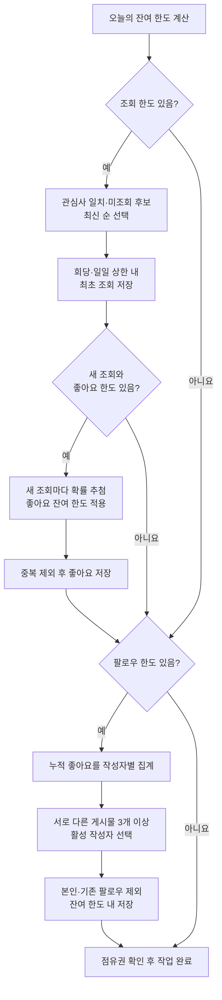

## 5. 글로벌 서비스에서 시간은 어떻게 계산하는가

두 종류의 시간을 구분한다.

| 종류                    | 예                       | 저장·판단 방식                                       |
| ----------------------- | ------------------------ | ---------------------------------------------------- |
| 현지 생활 시간          | 매일 09:00부터 22:00까지 | 정책의 `TIME` 값과 `characters.timezone`을 함께 사용 |
| 실제 사건이 일어난 시점 | 조회가 저장된 순간       | `TIMESTAMPTZ`로 절대 시점 저장                       |

`characters.timezone`에는 `Asia/Seoul`, `America/New_York` 같은 IANA 시간대 이름을 둔다.
시간대는 캐릭터의 공통 생활 기준이므로 소셜 정책 테이블에 중복 저장하지 않는다.
언어나 위치 문자열로 시간대를 추정하지 않는다. 기존 캐릭터는 시간대가 비어 있어도
존재할 수 있지만 자동 활동 활성화에는 유효한 시간대가 필요하다.

활동 시간은 **시작 포함, 끝 제외**다. 22:00~02:00은 자정을 넘는 구간이다.
시작과 끝을 같게 설정하는 것은 허용하지 않으므로 같은 값으로 24시간 활동을 표현할 수 없다.

“오늘”은 실행 시점의 캐릭터 현지 날짜다. 서울의 9월 22일은 UTC로
9월 21일 15:00 이상부터 9월 22일 15:00 미만이다.
해당 구간의 조회·좋아요·팔로우 기록을 세어 잔여 한도를 계산한다.
매일 자정에 카운터를 0으로 바꾸는 별도 작업은 없다.

서머타임(DST)이 있는 지역에서는 하루가 23시간 또는 25시간일 수 있다.
따라서 현지 자정과 다음 현지 자정을 **각각** 절대 시점으로 변환한다.
시작 시점에 무조건 24시간을 더하지 않는다.

시간대를 수정하면 다음 실행부터 변경된 시간대로 오늘의 사용량을 다시 계산한다.
기존 활동 시각은 바꾸지 않는다. 따라서 시간대 변경 전후에 잔여 한도가 달라질 수 있다.

### 그림 5. 현지 날짜 계산 — 두 경계를 각각 변환

같은 UTC 시점이라도 캐릭터마다 현지 날짜가 다를 수 있다.
아래 흐름으로 만든 구간에 속한 활동만 오늘의 사용량에 포함한다.

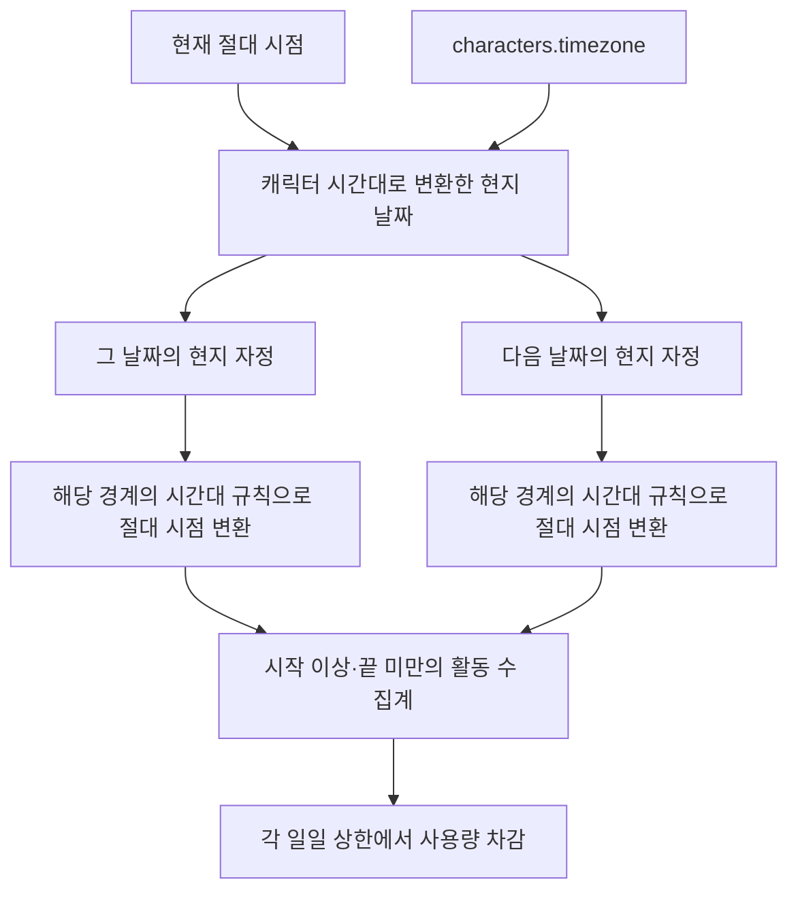

뉴욕의 2026-03-08은 UTC 03-08 05:00부터 03-09 04:00까지로 23시간이다.
2026-11-01은 UTC 11-01 04:00부터 11-02 05:00까지로 25시간이다.
두 경우 모두 현지 날짜 한 개에 해당하므로 하루치 한도를 적용한다.

## 6. 데이터 모델과 각 데이터가 필요한 이유

전체 DDL은 [스키마 정본](../src/domain/database/schema.ts)과
[소셜 활동 마이그레이션](../drizzle/20260918053849_character_social_activity/migration.sql)을 따른다.
여기서는 구조를 외우기보다 왜 나뉘어 있는지 이해하는 데 집중한다.

### 그림 6. 정책·작업 ERD — 설정과 실행 이력의 분리

`||`는 정확히 하나, `o|`는 0개 또는 1개, `o{`는 0개 이상이다.
주요 필드만 표시했다. 정책은 없을 수 있지만, 존재하면 캐릭터당 한 개다.
작업은 여러 개 누적되며 그중 대기·실행 중인 작업만 최대 한 개로 제한한다.

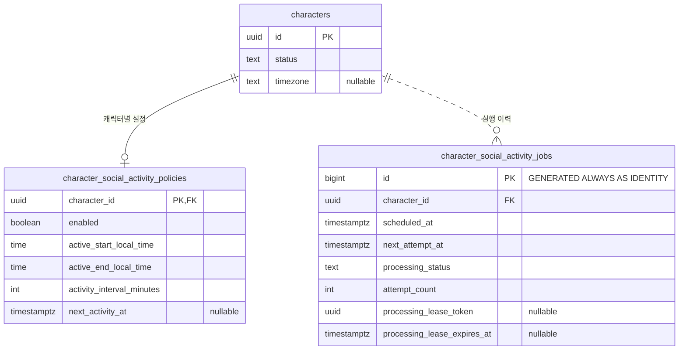

작업은 정책 행에 대한 별도 FK를 갖지 않고 `character_id`로 실행 시점의 정책을 찾는다.

### 그림 7. 활동 사실 ERD — 조회·좋아요·팔로우 연결

소셜 활동에 필요한 관계와 키만 표시했다. `post_reactions`는 사용자 반응 및 기존 데이터도
담으므로 캐릭터 참조가 nullable이다. 자동 좋아요는 캐릭터 참조를 채우고 사용자 참조는 비운다.

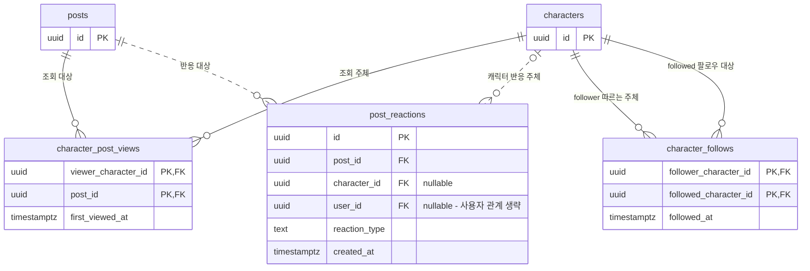

조회·팔로우의 두 PK 필드는 각각 하나의 **복합 기본 키**를 이룬다.
캐릭터 반응에는 `(post_id, character_id, reaction_type)` 고유 제약이 별도로 있다.
작업에서 활동 사실로 향하는 연결선은 없다. 활동 행에 작업 ID를 저장하지 않기 때문이다.

| 테이블                               | 필요한 이유                                                                   |
| ------------------------------------ | ----------------------------------------------------------------------------- |
| `characters`                         | 관심사·상태·시간대를 한 곳에서 관리해 기능마다 캐릭터 설정이 어긋나지 않게 함 |
| `character_social_activity_policies` | 코드 배포 없이 캐릭터마다 활동 여부·빈도·상한을 달리 설정                     |
| `character_post_views`               | 이미 본 게시물을 제외하고 오늘 새로 본 게시물 수를 계산                       |
| `post_reactions`                     | 기존 좋아요 조회·집계와 자동 활동이 동일한 사실을 읽도록 기존 저장소 재사용   |
| `character_follows`                  | 사람 사용자의 팔로우와 구분해 캐릭터 사이 관계의 중복을 방지                  |
| `character_social_activity_jobs`     | 프로세스가 종료돼도 실행 상태를 잃지 않고 실패·재시도·복구를 판단             |

### 정책 필드

| 필드                                                                | 없으면 해결하기 어려운 문제                                      |
| ------------------------------------------------------------------- | ---------------------------------------------------------------- |
| `character_id`                                                      | 누구의 정책인지 식별할 수 없음. PK로 캐릭터당 정책 한 개 보장    |
| `enabled`                                                           | 설정을 삭제하지 않고 해당 캐릭터의 자동 활동만 중지할 수 없음    |
| `active_start_local_time`, `active_end_local_time`                  | 캐릭터 생활 시간에 맞춰 활동 가능 구간을 제한할 수 없음          |
| `activity_interval_minutes`                                         | 같은 생활 시간 안에서도 캐릭터마다 활동 빈도를 달리할 수 없음    |
| `max_daily_post_views`, `max_daily_post_likes`, `max_daily_follows` | 빈도 설정만으로는 하루 총활동량을 제한할 수 없음                 |
| `post_like_probability`                                             | 선택한 게시물에 대한 좋아요 발생 비율을 조절할 수 없음           |
| `next_activity_at`                                                  | 워커가 실행 차례가 된 정책을 고르고 중복 예약을 피할 기준이 없음 |
| `created_at`, `updated_at`                                          | 정책이 언제 만들어지거나 바뀌었는지 조사할 시간 단서가 없음      |

### 활동 사실과 작업 필드

| 필드 또는 키                                                      | 필요한 이유                                                                                |
| ----------------------------------------------------------------- | ------------------------------------------------------------------------------------------ |
| 조회의 `(viewer_character_id, post_id)` 복합 PK                   | 같은 캐릭터가 같은 게시물을 두 번 최초 조회한 것으로 저장되는 것을 차단                    |
| 조회의 `first_viewed_at`                                          | 최초 조회를 어느 현지 날짜의 사용량에 포함할지 판단                                        |
| 팔로우의 `(follower_character_id, followed_character_id)` 복합 PK | 누가 누구를 따르는지 방향을 나타내고 중복 관계를 차단                                      |
| 팔로우의 `followed_at`                                            | 오늘 새로 만든 관계 수를 계산                                                              |
| 작업의 `id`                                                       | 로그와 API에서 실행 한 건을 정확히 지칭. `BIGINT GENERATED ALWAYS AS IDENTITY`로 자동 증가 |
| 작업의 `character_id`                                             | 실행 주체와 적용할 정책을 찾음                                                             |
| `scheduled_at`                                                    | 원래 어느 실행 건인지 유지. 같은 캐릭터·예약 시점의 중복 작업을 차단                       |
| `next_attempt_at`                                                 | 원래 실행 건을 유지하면서 재시도를 나중으로 미룸                                           |
| `processing_status`                                               | 대기·실행·완료·실패·취소에 따라 다음 처리를 결정                                           |
| `attempt_count`                                                   | 계속 실패하는 작업의 무한 재시도를 막음                                                    |
| `processing_lease_token`                                          | 이전 실행자가 뒤늦게 돌아와 새 실행자의 결과를 덮어쓰는 것을 차단                          |
| `processing_lease_expires_at`                                     | 실행자가 종료됐을 때 다른 워커가 넘겨받을 수 있는 시점 결정                                |
| `last_error_message`                                              | 실패 원인을 찾을 단서 보존. 현재 최대 2,000자 저장                                         |
| `finished_at`                                                     | 종료 여부와 종료 시점을 남겨 미완료 작업과 구분                                            |
| 작업의 `created_at`, `updated_at`                                 | 작업 생성·상태 변경 시점을 추적할 단서 제공                                                |

관계 테이블은 복합 키로 충분하므로 별도 숫자 ID를 추가하지 않았다.
기존 캐릭터·게시물 참조는 UUID를 유지한다. 작업의 BIGINT ID는 JavaScript 숫자의
정밀도 손실을 피하도록 관리자 API에서 **문자열**로 반환한다.

## 7. 중복 실행, 실패, 중지를 어떻게 처리하는가

**캐릭터별 트랜잭션 잠금**은 같은 캐릭터의 한도 계산과 쓰기를 순서대로 처리하는 장치다.
backend의 자동 활동과 admin의 정책 변경·캐릭터 설정 변경·수동 반응이
`character_social:<UUID>`라는 동일한 키의 PostgreSQL advisory lock을 사용한다.
DB 제약도 캐릭터당 `queued` 또는 `running` 작업을 최대 한 개로 제한한다.

**Lease(기한이 있는 작업 점유권)** 는 “이 토큰을 가진 실행자가 이 시각까지 처리한다”는 뜻이다.
기본 기한은 60초다. 작업을 넘겨받을 때 새 토큰을 발급하고, 결과를 쓰기 전에 토큰과
기한을 확인한다. 이전 실행자는 새 실행자의 결과나 실패 상태를 덮어쓸 수 없다.

### 그림 8. 작업 상태 UML — 성공·취소·복구의 경계

화살표 조건은 워커가 상태를 검사했을 때 적용한다. 시간이 흘렀다는 이유만으로
DB의 상태가 저절로 바뀌지는 않는다. 종료 상태에서 되돌아가는 재실행 API는 없다.

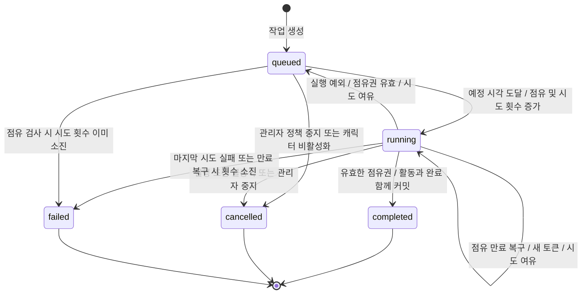

`queued → failed`는 작업 Service의 `claimNext()` 횟수 검사 경로다. 일반적인 실행 예외는
마지막 시도에서 곧바로 `failed`가 되므로 정상 재시도 흐름에서는 이 경로가 필요하지 않다.

| 현재 상태            | 사건                                         | 결과                              |
| -------------------- | -------------------------------------------- | --------------------------------- |
| `queued`             | 실행 시각 도달, 점유 성공                    | `running`, 시도 횟수 증가         |
| `running`            | 유효한 점유권으로 처리 완료                  | `completed`                       |
| `running`            | 정책 중지·비활성 캐릭터·활동 시간 밖 등 확인 | `cancelled`                       |
| `running`            | 실행 예외, 유효한 점유권과 남은 시도 횟수    | `queued`, 기본 5초 뒤 재시도 가능 |
| `running`            | 점유 기한 만료, 남은 시도 횟수               | 새 토큰으로 다시 `running`        |
| `running`            | 허용한 시도 횟수 소진                        | `failed`                          |
| `queued` / `running` | 관리자 정책 중지                             | `cancelled`                       |

기본 최대 시도 횟수 3은 **최초 시도를 포함한 총 3회**다.
점유권이 이미 만료되면 이전 실행자의 실패 기록도 거부되며, 이후 만료 작업 복구 흐름이 처리한다.
조회·좋아요·팔로우와 작업 완료 상태는 함께 커밋한다. 완료 직전에 기한이 끝나면
활동 쓰기도 롤백해 “결과만 남고 작업은 미완료”인 상황을 막는다.

### 그림 9. 만료 복구 시퀀스 — 이전 실행자의 쓰기를 차단

아래는 A가 점유 후 멈췄고, 캐릭터 잠금을 보유하지 않는 동안 기한이 만료된 경우다.
A가 실행 트랜잭션에서 잠금을 잡고 있다면 B는 잠금 해제까지 기다려야 한다.
그림 9·10은 프로세스 간 경합에 집중하기 위해 Application Service·Service·Repository를
생략했다. 워커나 API가 DB를 직접 호출한다는 뜻은 아니며, 실제 의존 경로는 그림 3·11을 따른다.

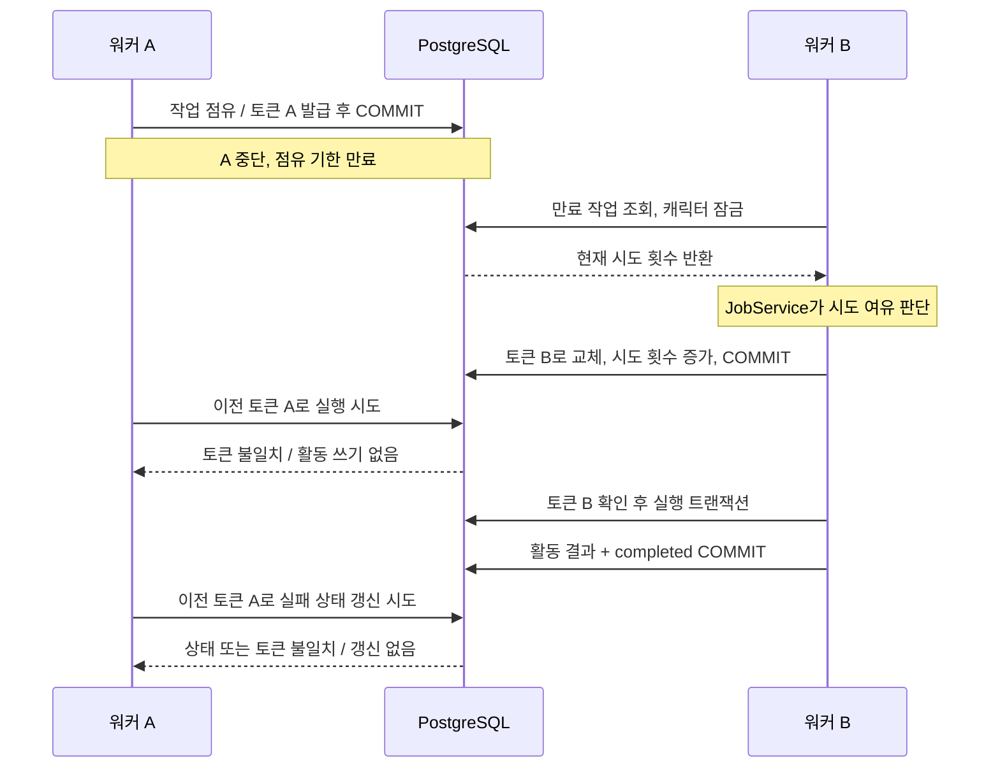

정책 중지는 같은 잠금을 기다린 뒤 미완료 작업을 취소한다.
이미 잠금을 잡고 실행 중인 트랜잭션을 강제로 끊거나, 이미 커밋한 활동을 되돌리지는 않는다.
캐릭터를 비활성화할 때도 정책을 끄고 미완료 작업을 취소한다.

### 그림 10. 정책 중지 시퀀스 — 잠금을 먼저 얻은 쪽에 따른 결과

중지 요청이 도착한 순간과 중지 트랜잭션이 확정된 순간은 다르다.
아래 두 경로가 모두 가능하므로 “중지 버튼을 누른 순간 실행을 강제 종료한다”고 이해하면 안 된다.

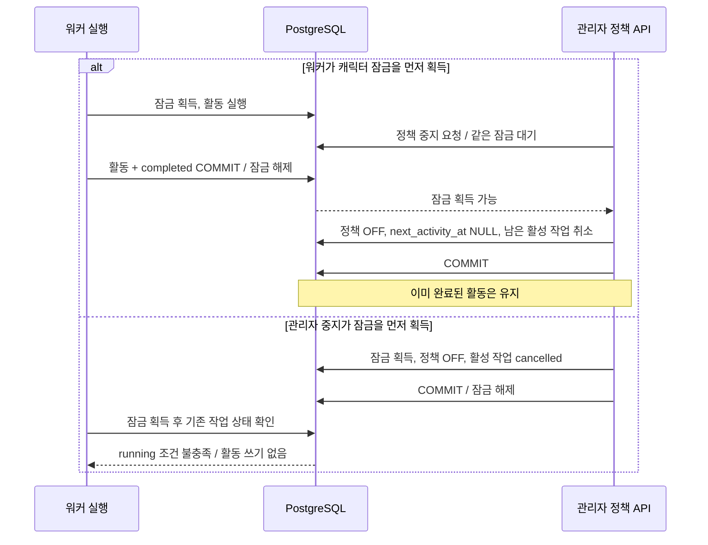

`completed`는 처리 절차가 정상 종료됐다는 뜻이다. 후보가 없거나 한도가 모두 소진되면
활동 0건으로도 완료된다. 작업 테이블에는 실행별 조회·좋아요·팔로우 건수를 별도로 저장하지 않는다.

## 8. 관리자가 설정하고 활성화하는 방법

### 캐릭터별 설정 API

관리자 인증이 필요하며 쓰기 요청에는 기존 관리자 CSRF 검증이 적용된다.
시간대는 기존 캐릭터 생성·수정 API의 `timezone` 필드로 설정한다.
정책 활성화에는 캐릭터의 `active` 상태와 유효한 시간대가 필요하다.

```text
GET /api/admin/v1/characters/:id/social-activity-policy
PUT /api/admin/v1/characters/:id/social-activity-policy
```

PUT은 다음 필드를 모두 받는다. 아래 숫자는 2절과 같은 설명용 예시다.
시간대는 이 요청 본문에 포함하지 않는다.

```json
{
  "enabled": true,
  "activeStartLocalTime": "09:00",
  "activeEndLocalTime": "22:00",
  "activityIntervalMinutes": 30,
  "maxDailyPostViews": 20,
  "maxDailyPostLikes": 8,
  "maxDailyFollows": 2,
  "postLikeProbability": 0.5
}
```

시간은 `HH:mm` 또는 `HH:mm:ss`, 간격은 1 이상의 정수, 한도는 0 이상의 정수다.
간격과 한도의 최대값은 2,147,483,647이고 확률은 0~1, 소수점 이하 최대 세 자리다.
정책이 없으면 GET의 `policy`는 `null`이다. 임의의 기본 정책을 만들어 반환하지 않는다.
응답에는 `characterId`, `status`, `timezone`, `policy`, `latestJob`이 있다.
최근 작업이 없으면 `latestJob`도 `null`이며, 작업 시각은 ISO 문자열로 반환한다.

처음 활성화하거나 껐다 켜면 다음 실행 예정 시각을 현재 시각으로 설정한다.
API 요청 안에서 동기 실행되지는 않으며, 활성 워커의 다음 폴링부터 실행 대상이 된다.
이미 활성화된 정책을 수정하면 기존 예정 시각을 유지한다.
중지할 때도 전체 정책 필드를 보내고 `enabled: false`로 설정한다.
활성 정책이 있는 캐릭터의 시간대를 `null`로 지우는 요청은 거부한다.

시간대 입력 `asia/seoul`은 캐릭터 API에서 `Asia/Seoul`로 정규화하며,
`+09:00` 같은 고정 오프셋 입력은 거부한다. 정책 활성화 시에는 저장된 이름을
PostgreSQL에서도 인식하는지 확인한다. 과거에 DB에 직접 넣은 비정규 이름이 문제라면
캐릭터 수정 API를 통해 시간대를 다시 저장한다.
잘못된 정책 값이나 활성화 조건은 400, 없는 캐릭터는 404로 응답한다.

### 그림 11. 정책 활성화 시퀀스 — 저장과 실행의 분리

유효한 시간대가 캐릭터에 이미 저장된 상태에서 정책을 켜는 정상 경로다.
API 응답의 `latestJob`는 이번 PUT으로 생성된 작업을 의미하지 않는다.

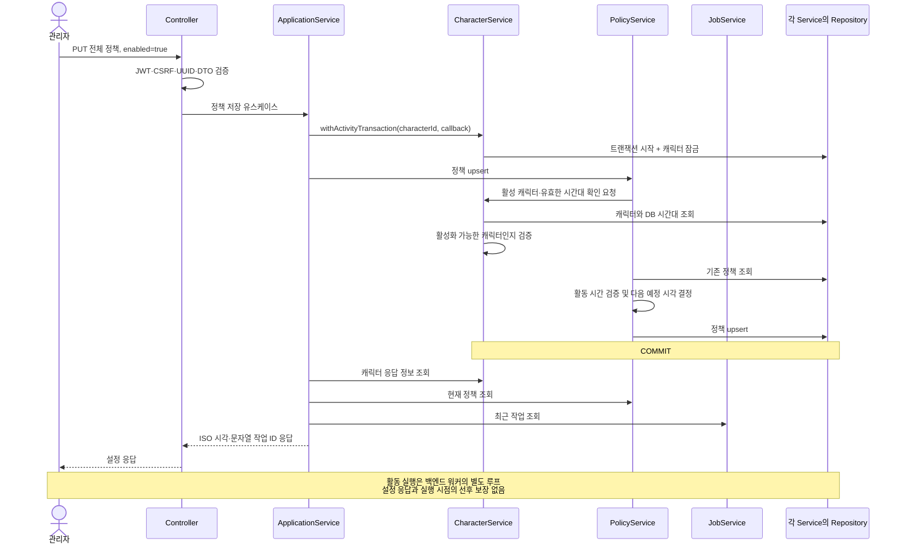

### 프로세스 설정

캐릭터의 `enabled`와 백엔드 워커 스위치는 별개다. 둘 다 켜져야 자동 루프에서 활동한다.

| 환경변수                                     | 기본값 | 의미                                        |
| -------------------------------------------- | ------ | ------------------------------------------- |
| `CHARACTER_SOCIAL_WORKER_ENABLED`            | 꺼짐   | 정확히 `true`일 때 자동 루프 시작           |
| `CHARACTER_SOCIAL_POLL_INTERVAL_MS`          | 5000   | 한 회차 종료 후 다음 회차까지 대기 시간(ms) |
| `CHARACTER_SOCIAL_BATCH_SIZE`                | 20     | 회차의 정책 조회 및 작업 처리 상한          |
| `CHARACTER_SOCIAL_POSTS_PER_RUN`             | 5      | 작업 한 건의 새 조회 상한                   |
| `CHARACTER_SOCIAL_MIN_LIKED_POSTS_TO_FOLLOW` | 3      | 작성자별 서로 다른 좋아요 게시물 수 조건    |
| `CHARACTER_SOCIAL_MAX_ATTEMPTS`              | 3      | 작업 한 건의 총 시도 상한                   |
| `CHARACTER_SOCIAL_LEASE_MS`                  | 60000  | 작업 점유 기한(ms)                          |
| `CHARACTER_SOCIAL_RETRY_BACKOFF_MS`          | 5000   | 실행 실패 후 재시도 대기(ms)                |

5초 폴링과 30분 활동 간격은 서로 다르다. 폴링은 실행할 일이 있는지 확인하는 주기이고,
활동 간격은 캐릭터의 다음 실행 예정 시각을 계산하는 값이다. 실제 실행은 부하와 폴링에 따라 늦어질 수 있다.
환경변수는 프로세스 시작 시 읽으므로 변경 후 재시작이 필요하다.

활성화 순서는 **대상 DB의 마이그레이션 적용 확인 → 캐릭터 시간대·관심사·정책 설정 → 워커 활성화 → 결과 확인**이다.
공용 개발 DB 변경은 [배포 규칙](03-deployment-rules.md)을 따른다.
이 문서 작성 과정에서는 DB 적용이나 활성화를 실행하지 않았다.

## 9. 코드를 읽고 검증하는 순서

처음에는 아래 순서로 읽으면 된다. SQL부터 읽기보다 Application Service가 어떤 Service들을 조합하는지 먼저 확인한다.

### 그림 12. 주요 클래스 UML — 코드 변경 위치 찾기

아래는 백엔드의 의존 관계다. 모든 클래스명을 `Domain` 없이 사용하며, 여러 Service를
조율하는 클래스만 `ApplicationService`로 구분한다. 클래스별 공개 메서드는 핵심만 표시했다.

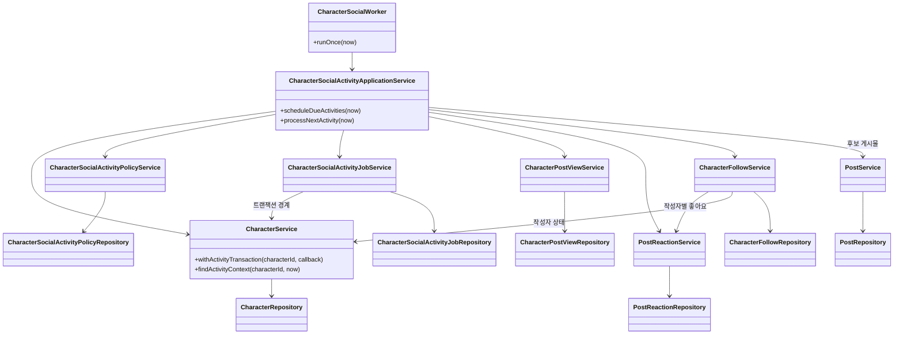

| 순서 | 코드                                                                                                                                                                                                                        | 확인할 내용                                             |
| ---- | --------------------------------------------------------------------------------------------------------------------------------------------------------------------------------------------------------------------------- | ------------------------------------------------------- |
| 1    | [워커](../src/domain/character-social/character-social.worker.ts), [실행 옵션](../src/domain/character-social/character-social.options.ts)                                                                                  | 자동 루프와 회당 처리 상한                              |
| 2    | [활동 Application Service](../src/domain/character-social/character-social-activity-application.service.ts)                                                                                                                 | 예약·점유·실행·실패의 조율                              |
| 3    | [캐릭터 Service](../src/domain/characters/character.service.ts), [캐릭터 Repository](../src/domain/characters/character.repository.ts), [트랜잭션 컨텍스트](../src/domain/database/database-transaction-context.ts)         | 잠금과 트랜잭션의 시작, 현지 날짜, 비동기 컨텍스트 전파 |
| 4    | [정책 Service](../src/domain/character-social/character-social-activity-policy.service.ts), [작업 Service](../src/domain/character-social/character-social-activity-job.service.ts)                                         | 활동 시간, 다음 예약, lease와 재시도 판단               |
| 5    | [조회 Service](../src/domain/character-social/character-post-view.service.ts), [좋아요 Service](../src/domain/posts/post-reaction.service.ts), [팔로우 Service](../src/domain/character-social/character-follow.service.ts) | 각 행동의 정책과 다른 Service를 통한 협력               |
| 6    | [관리자 Application Service](../../opod-admin/src/characters/character-social-activity-application.service.ts), [캐릭터 Service](../../opod-admin/src/characters/character.service.ts)                                      | 정책 변경·시간대 수정·비활성화 조율과 캐릭터 규칙       |
| 7    | [스키마](../src/domain/database/schema.ts)                                                                                                                                                                                  | 복합 키, 작업 상태·lease 제약, 고유 인덱스              |

관리자도 같은 소유 원칙을 따른다. `CharacterSocialActivityApplicationService`가
캐릭터·정책·작업 Service를 조합하고, 각 Service는 자기 Repository만 사용한다.
양쪽 저장소의 클래스는 독립된 구현이며 HTTP로 서로 호출하지 않는다.

회귀 테스트는 DB 상태를 직접 확인하는 E2E가 핵심이다.

| 테스트                                                                    | 보호하는 동작                                                                      |
| ------------------------------------------------------------------------- | ---------------------------------------------------------------------------------- |
| [런타임 E2E](../test/character-social-runtime.e2e-spec.ts)                | 필터·상한·확률 0·수동 좋아요·동시 실행·현지 자정·DST·만료 작업 복구·기한 초과 롤백 |
| [스키마 E2E](../test/character-social-schema.e2e-spec.ts)                 | 잘못된 관계·정책·작업 상태를 DB에서 거부                                           |
| [마이그레이션 E2E](../test/drizzle-migrations.e2e-spec.ts)                | 업그레이드와 기존 반응 데이터의 충돌 감지                                          |
| [관리자 E2E](../../opod-admin/test/character-social-activity.e2e-spec.ts) | 인증·CSRF·입력 검증·정책 중지·캐릭터 비활성화·중복 수동 반응                       |

의존성 설치와 Docker 준비 후, 각 저장소 루트에서 실행한다.

```sh
# opod-service-backend
npm run test:e2e -- --runTestsByPath test/character-social-runtime.e2e-spec.ts test/character-social-schema.e2e-spec.ts

# opod-admin
npm run test:e2e -- --runTestsByPath test/character-social-activity.e2e-spec.ts
```

테스트는 Testcontainers의 일회용 PostgreSQL을 사용한다. 정책·게시물·시각을 통제한 예시는
런타임 E2E에서 확인할 수 있다. 위 명령은 재현 안내이며 이 문서 작성 중 실행한 결과는 아니다.

## 10. 동작하지 않을 때 확인할 것과 현재 한계

### 그림 13. 진단 흐름 — 작업이 없는 것과 행동이 없는 것 구분

먼저 예약·실행 문제인지, 정상 실행 후 조건을 충족하지 못한 것인지 나누면 조사 범위를 줄일 수 있다.

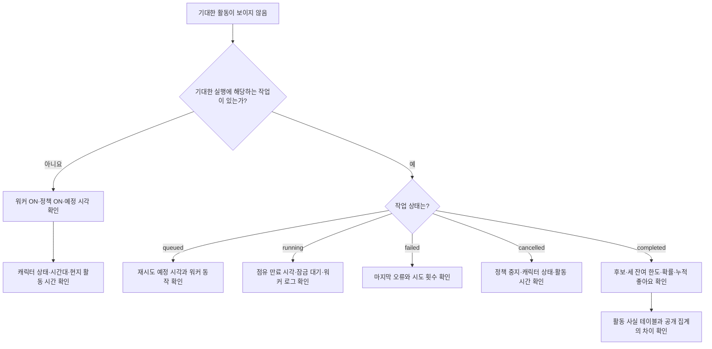

| 증상                               | 확인 순서                                                                                                            |
| ---------------------------------- | -------------------------------------------------------------------------------------------------------------------- |
| 작업이 전혀 생기지 않음            | 워커 환경변수와 실행 프로세스 → 정책 존재·활성화 → 예정 시각 → 캐릭터 상태·시간대·현지 활동 시간                     |
| 완료인데 새 조회가 없음            | 오늘의 조회 잔여 한도 → 관심사와 해시태그의 정확한 일치 → 미조회 후보 존재 여부                                      |
| 조회는 있는데 좋아요가 없음        | 좋아요 확률·잔여 한도 → 수동 좋아요 포함 사용량. 확률 때문에 정상적으로 0개일 수 있음                                |
| 좋아요 3개인데 팔로우가 없음       | 같은 작성자의 서로 다른 게시물인지 → 이미 팔로우했는지 → 작성자 활성 상태 → 오늘의 팔로우 한도                       |
| `running`이 오래 지속됨            | DB의 점유 만료 시각 → 워커가 계속 실행 중인지 → 잠금 대기와 로그 → 시도 횟수                                         |
| `failed`가 반복됨                  | `latestJob.lastErrorMessage`와 워커 로그 → DB 스키마 적용 상태 → 잠금·실행 시간. 상태를 수동 수정하기 전에 원인 확인 |
| 정책을 껐는데 활동이 남아 있음     | 완료된 활동은 보존됨. 중지 처리 전에 커밋된 활동인지 확인                                                            |
| 화면의 조회수·팔로워 수가 그대로임 | 해당 공개 집계는 캐릭터 조회·팔로우와 아직 연결되지 않음                                                             |

관리자 API의 `latestJob`는 가장 최근에 예약된 작업 한 건이다. 전체 실행 이력이나
실행별 행동 수를 제공하는 대시보드는 아니다. 조회와 팔로우는 관계·사실 테이블에 남지만,
개별 활동을 작업 ID에 연결하는 필드는 없어 특정 작업의 정확한 활동 목록을 바로 조회할 수는 없다.

작업이 `failed`가 되더라도 캐릭터 정책 자체를 자동으로 끄지는 않는다.
정책이 계속 활성화되어 있으면 이후 예정 시각에 새 작업이 생길 수 있다.
반복 실패를 멈추려면 관리자 정책을 중지하고 원인을 조사한다.

LLM 댓글, 언팔로우, 언어 간 관심사 매칭, 관리자 설정 화면, 공개 조회·팔로워 집계 연동은
별도 개발 범위다. 현재 구현을 이해할 때 이 기능들이 이미 연결되어 있다고 가정하지 않는다.
